# OVO Customer Analysis

**Goal:** Profile who registers through the OVO partnership, how good their credit is, when they show up, and whether a form change shifted the mix. Also test a cross-sell hypothesis on a wider customer base.  
**Role:** Data Analyst. Ran the analysis end to end: queries, charts and write-up.  
**Tools (visible in the screenshots):** Metabase, Amplitude, Google Sheets  

This case study combines three analyses:
1. [Who the OVO customers are](#1-who-the-ovo-customers-are): credit quality, demographics, device and behaviour
2. [Did the Typeform change who registers?](#2-did-the-typeform-change-who-registers): before vs after
3. [Do good customers use multiple banks?](#3-do-educated-urban-customers-use-multiple-banks): a cross-sell test

---

## 1. Who the OVO customers are

OVO is a partner channel ("OVO Partnerships" in the charts). The question was whether OVO brings in customers with good enough credit to be worth converting, and what to do about the rest.

### Credit score

For OVO users with a SLIK score, the score has two groups: a large cluster between roughly 480 and 560, and a long tail between 200 and 400.

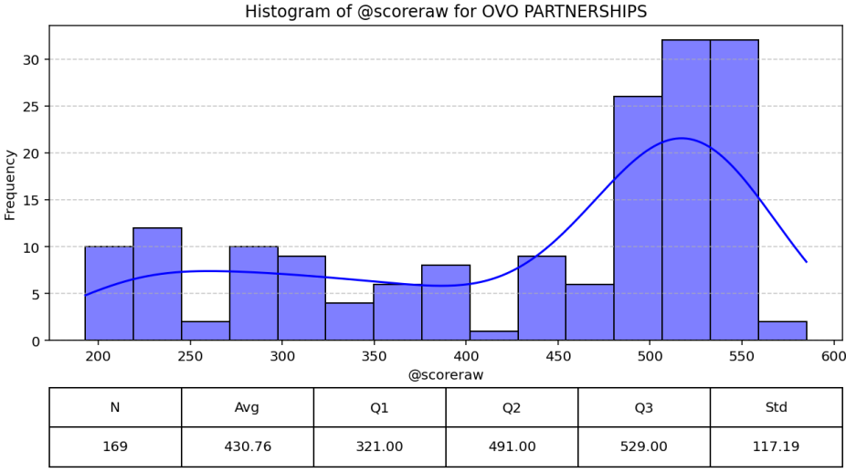

| N | Mean | Q1 | Median | Q3 |
|---|---|---|---|---|
| 169 | 430.8 | 321 | 491 | 529 |

Many OVO users have **no score at all**. Breaking those down by SLIK's own error message, most are flagged `BAD_CREDIT_HISTORY` (325), then `NO_CREDIT_HISTORY` (75). A handful have no active credit, only outdated credit, or contracts too new to rate.

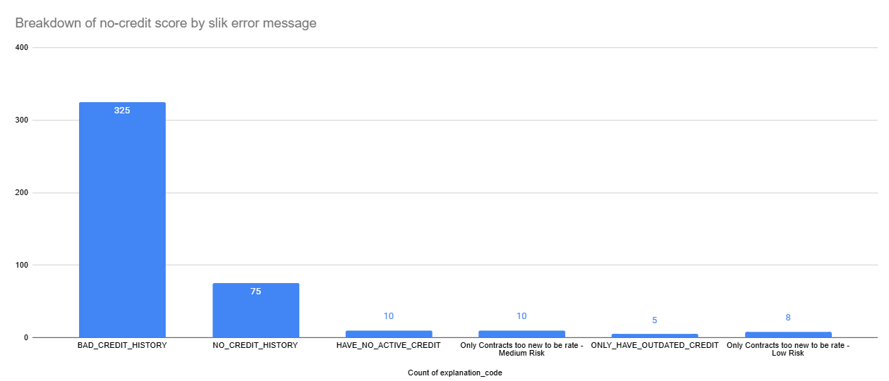

### Age, credit activity and capacity

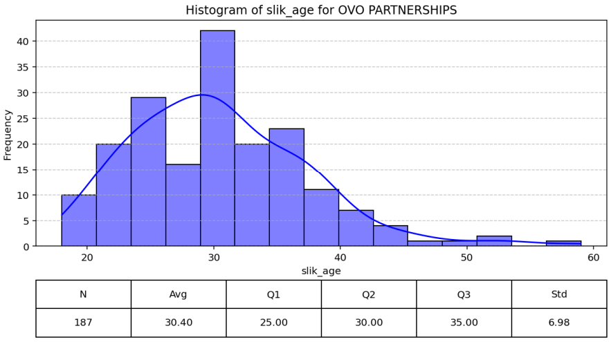
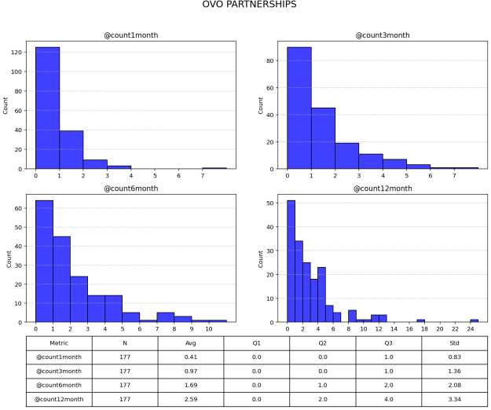

- **Age:** a young base. Mean 30.4, median 30, with most users between 25 and 35.
- **Credit footprint** (credit activity counts over the last 1, 3, 6 and 12 months): most users show little recent activity. The median is 0 over the last month and 2 over the last 12 months.

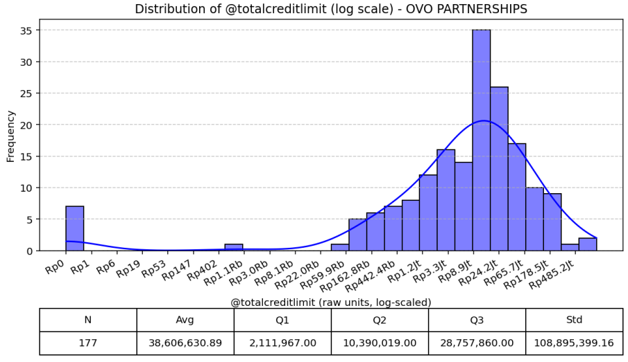
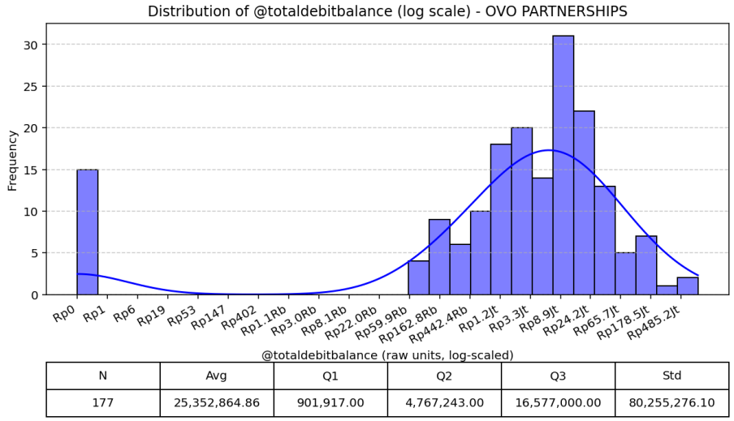
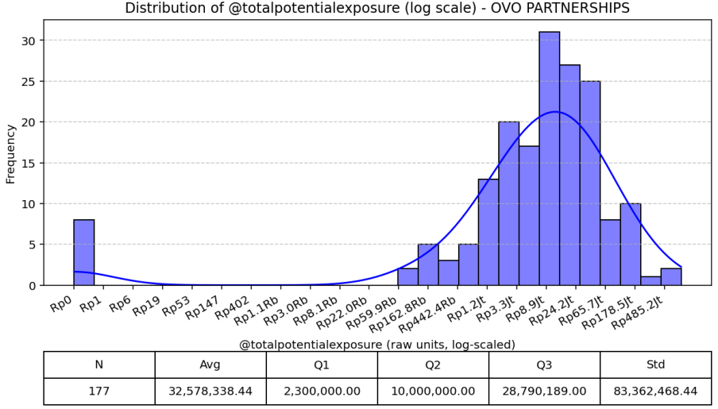

*(Left to right: total credit limit, total debit balance, total potential exposure. Log scale.)*

For the 177 users in these charts, the median credit limit is about Rp 10.4M, the median debit balance about Rp 4.8M, and the median potential exposure Rp 10.0M. A small group sit at Rp 0: 7 users for credit limit, 15 for debit balance and 8 for potential exposure.

### Device: counting devices per user is unreliable

Amplitude creates a new ID for each unique user and device pairing, and a different browser on the same phone counts as a new device. So counting devices per user by device ID overcounts, while counting by device type undercounts (two iPhones count as one). There is no reliable way to count how many devices a user has.

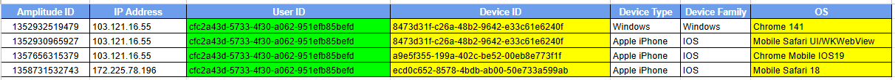

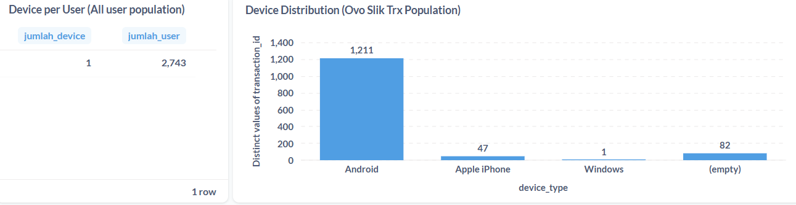
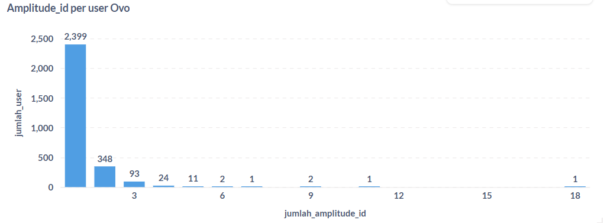

*(Left image: on the left, counting devices per user by device type gives exactly 1 device for all 2,743 users; on the right, the device distribution of the OVO SLIK transaction population. Right image: the number of Amplitude IDs per OVO user: 2,399 users have 1, 348 have 2, 93 have 3, 24 have 4, and a few have as many as 18. The table above shows one user with four Amplitude IDs across Windows and iPhone devices and different browsers.)*

By device type, Android dominates the OVO SLIK transaction population (1,211) against iPhone (47), Windows (1) and 82 with no device type recorded.

### Payment history (KOL) and geography

KOL is the SLIK collectability rating, from 1 (best) to 5 (worst). The worst rating, KOL 5, is by far the largest group (745 transactions), followed by KOL 1 (247) and KOL 2 (224), with KOL 3 (32) and KOL 4 (44) small.

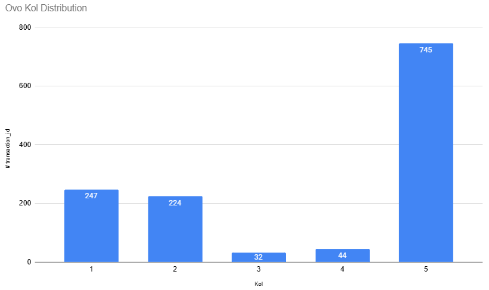

Comparing KOL 1 and KOL 5 by city shows a trade-off: where the share of good KOL is high, the transaction volume is tiny, and where volume is big, KOL is generally bad.

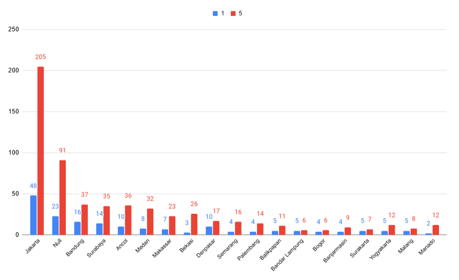
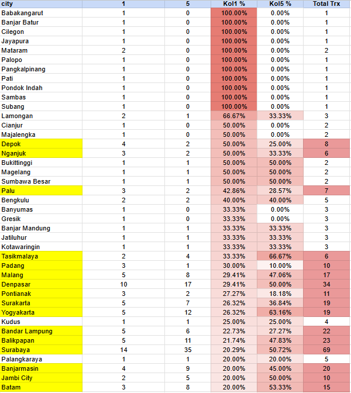

I sorted cities from best to worst KOL and looked for a middle ground: **more than 5 transactions and at least 20% KOL 1**. The cities highlighted in yellow on the sheet pass that test: Depok, Nganjuk, Palu, Tasikmalaya, Padang, Malang, Denpasar, Pontianak, Surakarta, Yogyakarta, Bandar Lampung, Balikpapan, Surabaya, Banjarmasin, Jambi City and Batam. Jakarta has the largest volume (363 transactions) but only about 10% of its users score above 500.

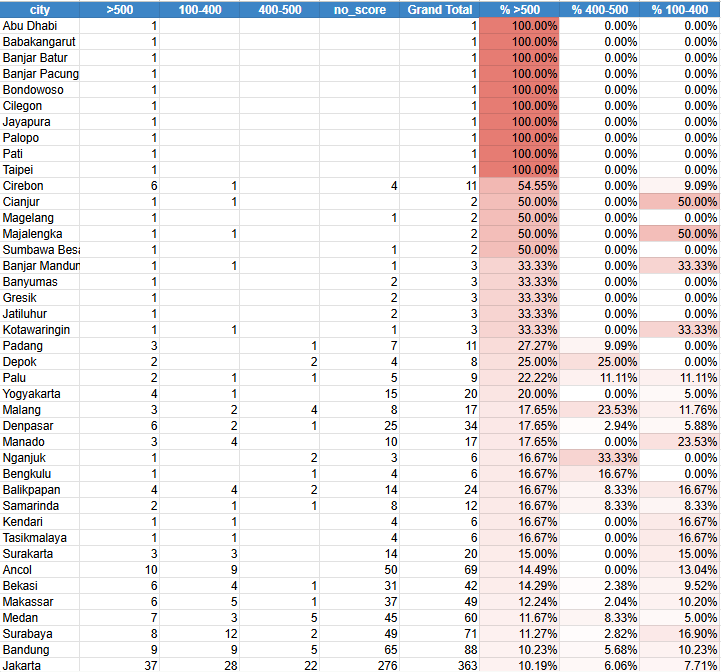

### Gender

Female customers have better odds of a good payment history, although they are a small share of the base.

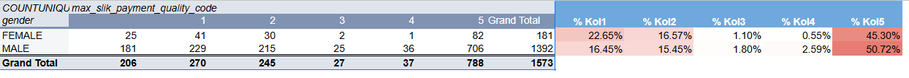
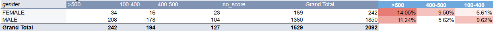

- **KOL 1 and 2 combined:** about 39% of female customers vs 32% of male.
- **KOL 4 and 5 combined:** about 46% of female vs 53% of male.
- **Score above 500:** 14.1% of female vs 11.2% of male.

Both genders are still dominated by KOL 5.

### When customers register

Male customers dominate registrations on every day of the week (1,392 men vs 181 women in the KOL table above) and are busiest from Friday to Sunday (301 to 313 a day, against 199 to 277 on other days). Men's registrations peak late at night, around 21:00 to 02:00 (75 to 83 an hour, with a smaller peak at 12:00 and 19:00); women's peak at 16:00 and 20:00 (15 each). Women's busiest days are Saturday (52) and Thursday (42).

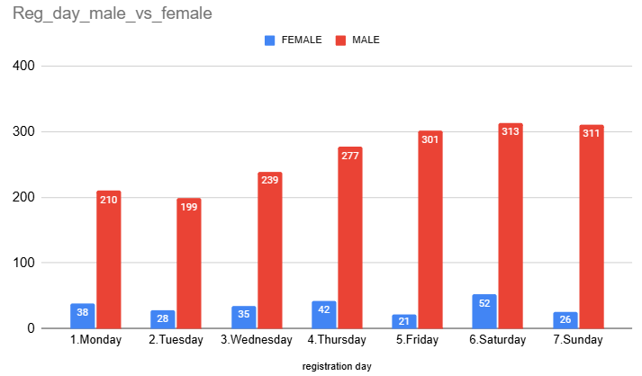

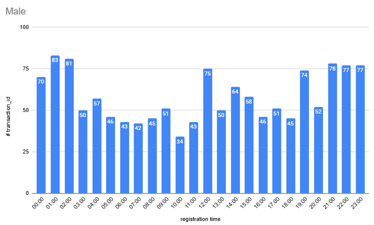
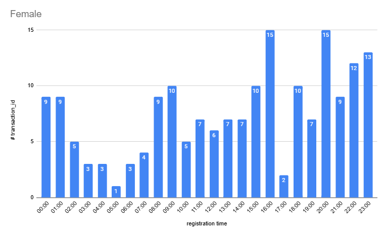

*(Registrations by day, then by hour for men, then for women. Female counts are small.)*

### iPhone vs Android

iPhone users have noticeably better credit than Android users, but the iPhone sample is small (62 vs 1,416).

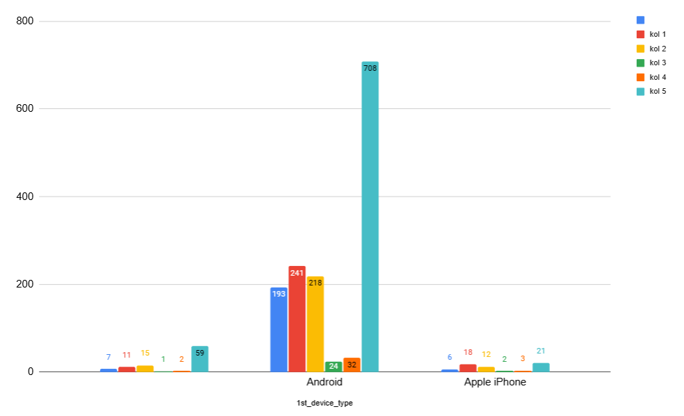
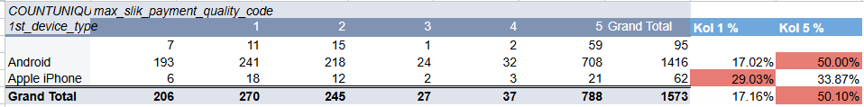

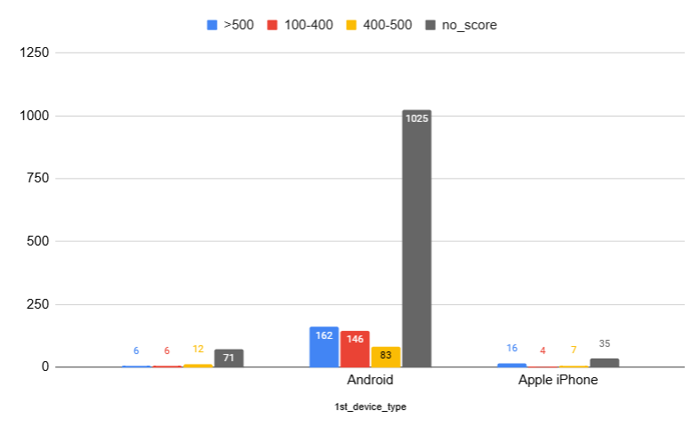
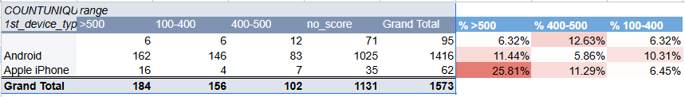

| | KOL 1 | KOL 5 | Score above 500 | High education |
|---|---|---|---|---|
| iPhone | 29.0% | 33.9% | 25.8% | 21.0% |
| Android | 17.0% | 50.0% | 11.4% | 13.1% |

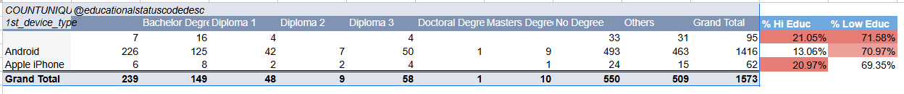

### iPhone users: weekend browsers vs weekday applicants

Among iPhone registrants, the ones **without a SLIK result** register most on Saturday (23) and Sunday (21), against 15 to 19 on other days, with registrations spread across the whole day. The ones **with a SLIK result** register most on Tuesday (19) and Wednesday (17), against 7 to 16 on other days, with a peak at 17:00 (after office hours). The differences are modest, not a clean split.

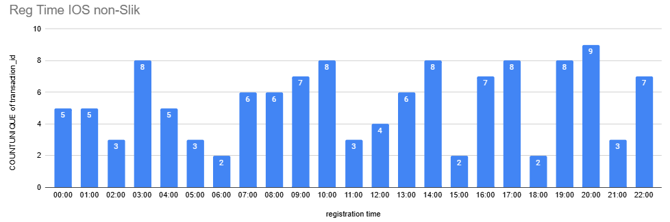
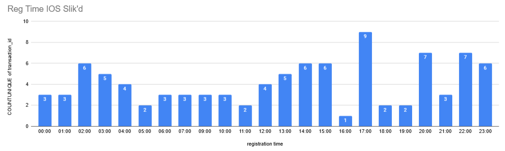

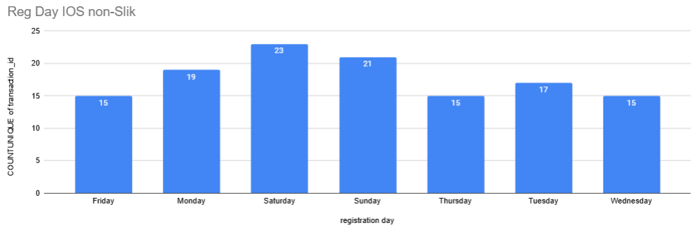
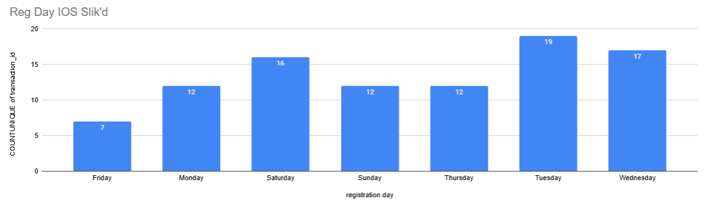

*(Top row: registration hour, no SLIK vs SLIK. Bottom row: registration day, no SLIK vs SLIK.)*

**Hypothesis (not tested):** weekend iPhone registrants are curious and just checking things out, while weekday registrants are more serious. If so, **sending a reminder to the no-SLIK iPhone group on a workday** could bring back people who meant to continue.

---

## 2. Did the Typeform change who registers?

After the Typeform was implemented (the "after" data starts 22 Oct 2025), I compared the registrant mix before and after on a Metabase dashboard.

| Measure | Before | After |
|---|---|---|
| Registrations in window | 2,486 | 187 |
| iPhone share, daily average | 9.7% | 12.06% |
| iPhone share, overall | 4.22% | 8.02% |
| High-education share, daily average | 6.88% | 8.71% |
| High-education share, overall | 12.8% | 19.3% |
| Low-education share | 68.7% | 58.8% |
| Female share | 11.5% | 14.4% |

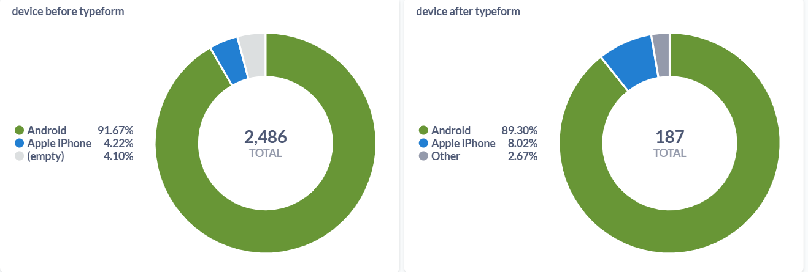
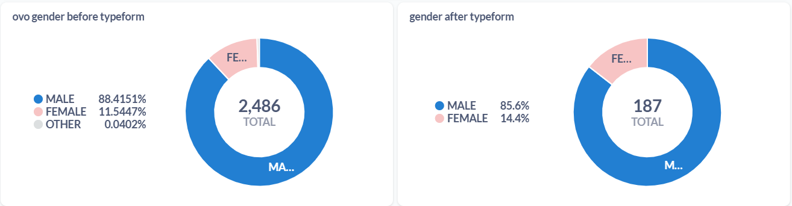

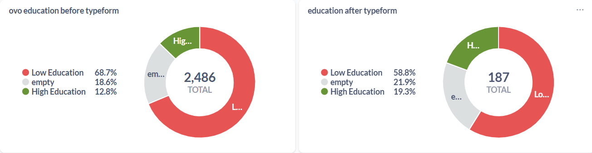

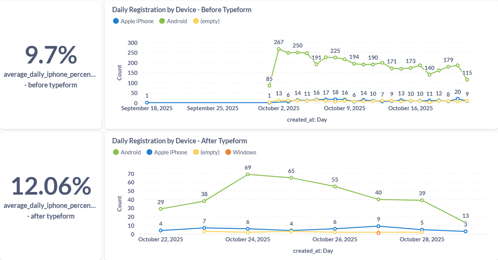

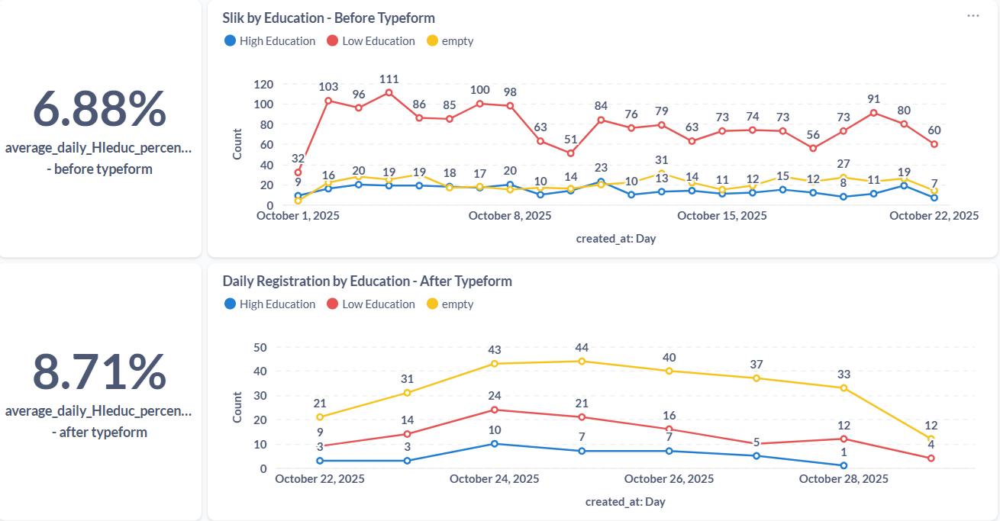

- **Device:** the Typeform raised the iPhone share. This is good if iPhone users are more capable borrowers, which the first analysis supports.
- **Education:** low-education registrants fell and high-education rose, though not dramatically.
- **Gender:** the female share rose slightly. This could be a good thing if women are more likely to repay.
- **Age:** not much change. Among registrants with an age, the 20 to 30 bracket is still the largest (24.7% before, 21.9% after). But age is empty for about half of registrants (49.4% before, 57.0% after), so this is a weak signal. (The age charts count 4,645 and 407 records, not 2,486 and 187 like the device, gender and education charts, so they are drawn from a differently filtered population.)
- **City:** the first city seen in Amplitude is still dominated by Jakarta.

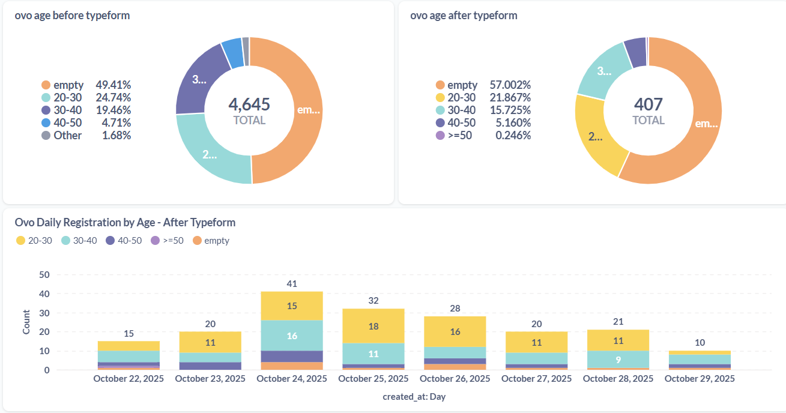
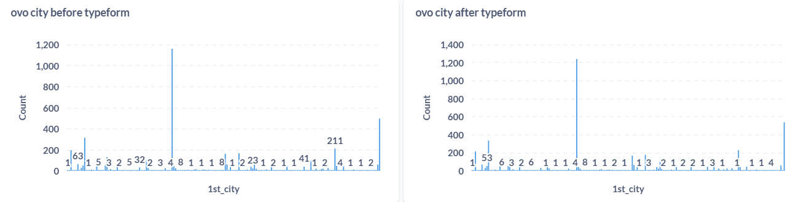

**Caveats:**
- The "after" window is only 8 days (22 to 29 Oct 2025) and 187 registrations, so this is a before and after comparison, not a controlled test.
- The "daily average" shares (9.7% to 12.06% for iPhone, 6.88% to 8.71% for high education) give each day equal weight. The "before" chart starts with a day that has a single registration (18 Sept), and low-volume days like that can distort an equal-weighted average. The overall shares (iPhone 4.22% to 8.02%, high education 12.8% to 19.3%) weight each registration equally and are the safer comparison. Both point the same way.

---

## 3. Do educated urban customers use multiple banks?

A separate analysis tested whether cross-selling could be a prospect.

**Hypotheses:** well-educated people living in urban areas (1) tend to own multiple bank accounts and (2) tend to hold multiple loans from different banks.

**Population:** only customers with a Bachelor, Diploma, Master's or Doctoral degree, combining borrowers and co-borrowers: **9,495 unique users**.

I counted distinct banks and contract types per person.

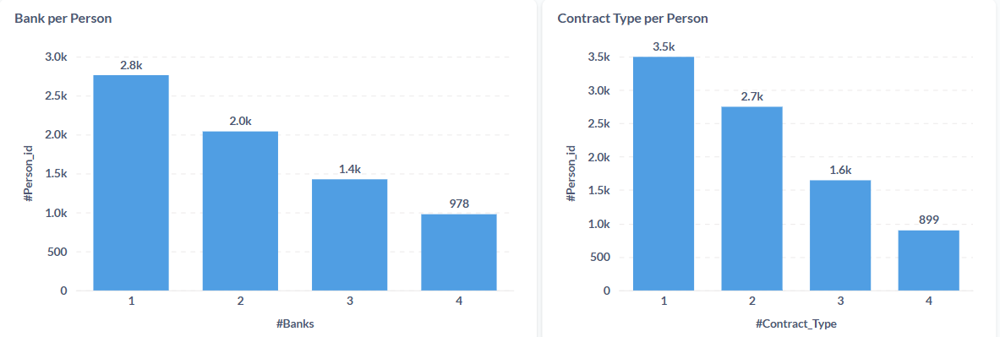

To make it easier to read, I grouped people into four categories:

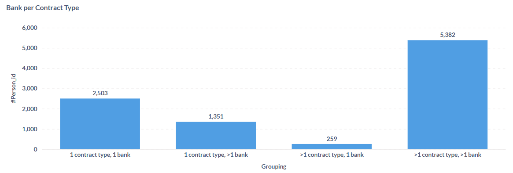

| Group | People |
|---|---|
| 1 contract type, 1 bank | 2,503 |
| 1 contract type, more than 1 bank | 1,351 |
| More than 1 contract type, 1 bank | 259 |
| More than 1 contract type, more than 1 bank | 5,382 |

- **Only 2,762 people (about 30%) use a single bank. 6,733 (about 70%) use several.**
- **5,382 people (about 57%) hold multiple loan types across multiple banks**, compared with just 259 who hold several loans at one bank.

Among those with more than one contract type, the most common case is 2 banks (about 1.4k people), and the count falls gradually from 3 banks (about 1.2k) to 4 (858) and 5 (646). Only 279 have a single bank:

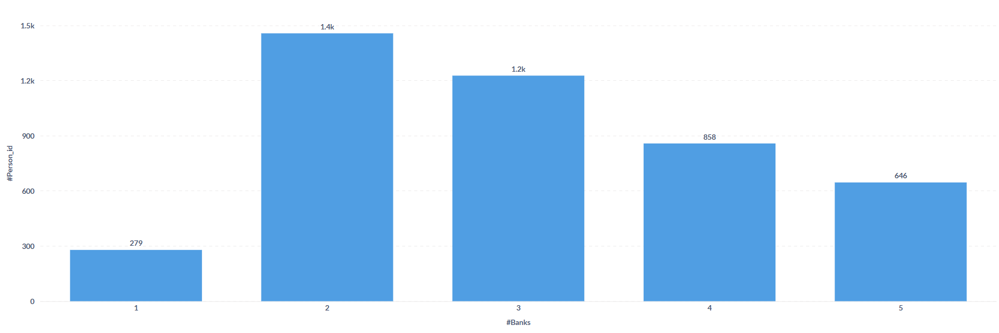

### Which products go together

For cross-selling I looked at which contract types each person holds together. The full network is hard to read, so I removed the weak connections.

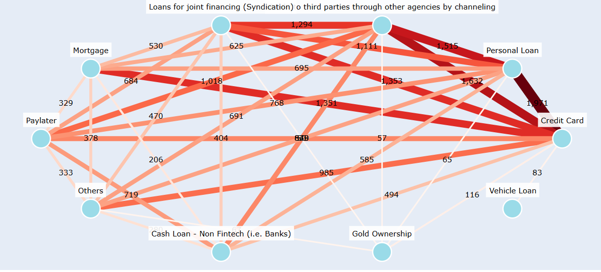
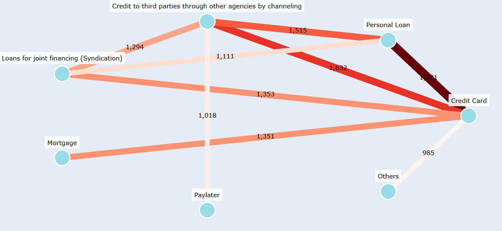

| Combination | People | Share of 9,495 |
|---|---|---|
| Credit card and personal loan | 1,971 | 20% |
| Credit card and credit via other agencies | 1,632 | 17% |
| Personal loan and credit via other agencies | 1,515 | 16% |
| Credit card and joint-financing loans | 1,353 | 14% |
| Mortgage and credit card | 1,351 | 14% |

The next most common pairs in the simplified network are joint-financing loans with credit via other agencies (1,294), personal loan with joint-financing loans (1,111), Paylater with credit via other agencies (1,018) and credit card with "others" (985).

**Conclusion:** both hypotheses hold for this educated population. These combinations are the natural targets for cross-selling. Note that the population was filtered by education only, so the "urban" part of the hypothesis was not tested separately.

## What I took away

- **OVO brings mostly young, mostly Android users, with a lot of missing or poor credit.** The score distribution is two-humped: a solid group above 480 and a long tail of weak or missing scores.
- **Pockets of quality exist.** iPhone users, female customers, and certain mid-sized cities have better credit than the base average.
- **A form change can shift the mix.** The Typeform moved registrants towards higher education and iPhone.
- **Good customers hold many loans at many banks,** which makes cross-selling a real option.

<!-- CHECK: the "empty credit score" chart totals ~433 users but the Notion note says "#145 data"; confirm which is right. -->
<!-- CHECK: the "1 bank among multi-contract customers" bar shows 279 but the grouping chart shows 259 people with more than one contract type at one bank; probably a small definition difference, confirm. -->
<!-- NOTE: all numbers in this file were checked against the screenshots. -->
<!-- CHECK: what exactly the Typeform asks, and when it went live (data starts 22 Oct 2025). -->
